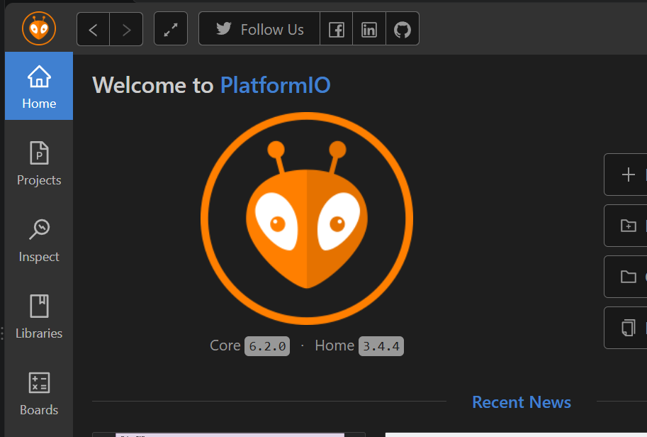
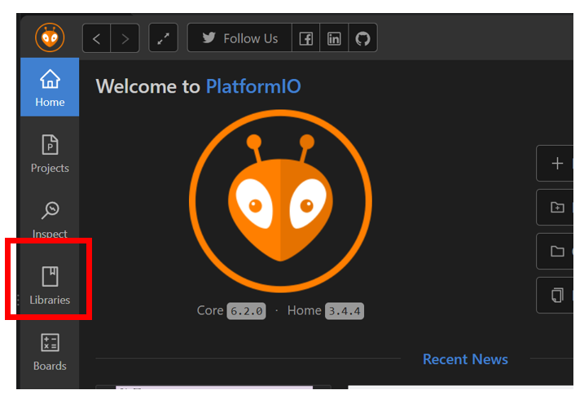
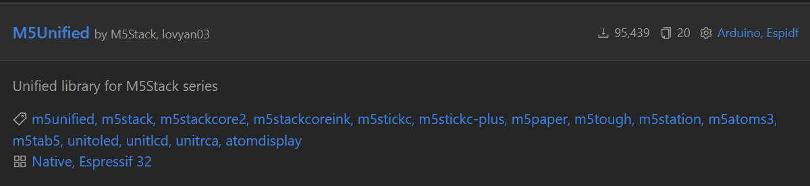
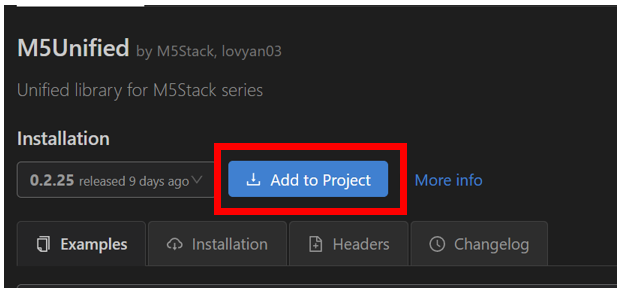
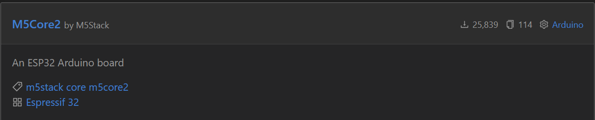
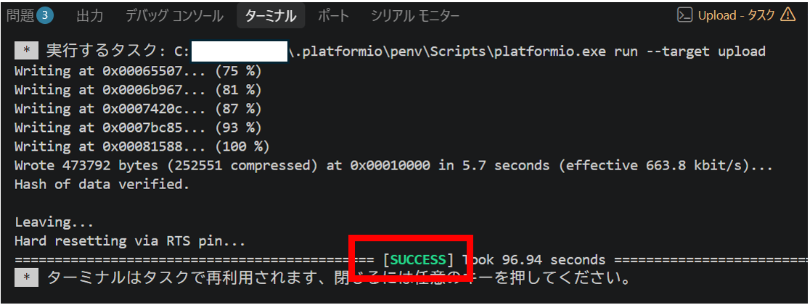

# M5Stack CORE2 PlatformIO 開発ガイド

[M5Stack CORE2] の開発環境として **PlatformIO (VS Code)** を使用したセットアップ手順をまとめてみました。
[参考サイト](https://logikara.blog/core2_2/)
---

## 目次

1. USBドライバのインストール
2. 開発環境の準備 (VS Code + PlatformIO)
3. プロジェクトの作成と初期設定
4. ライブラリのインストール
5. サンプルプログラムの書き込み・動作確認
6. トラブルシューティング: 通信ポートの強制指定
7. 工場出荷状態に戻す方法

---

## 1. USBドライバのインストール

CORE2のUSBチップには **CP2104** と **CH9102F** の2種類が存在します。正常に認識させるため、**両方のドライバ（CH9102およびCP210x）をあらかじめ両方インストール**してください。

* 📥 ドライバのダウンロード: [M5Stack Docs 公式ページ](https://docs.m5stack.com/ja/core/Core2)

---

## 2. 開発環境の準備 (VS Code + PlatformIO)

高機能エディタ VS Code 内で動作する [PlatformIO](https://logikara.blog/core2_2/#mokuji_4-1) を使用します。以下の順番でインストールを行います。

1. **[Visual Studio Code (VS Code)](https://logikara.blog/vscode_install/)** のインストール（および日本語化）
2. **[Python](https://logikara.blog/python_install/)** のインストール
3. VS Codeの拡張機能（Extensions）から **[PlatformIO](https://logikara.blog/install_platform/)** をインストール<br>
※インストール方法については省略します。
---

## 3. プロジェクトの作成と初期設定

1. PlatformIOを起動し、画面左下の「ホームアイコン」（Home）をクリックします。
2. 「New Project」をクリックします。
3. 設定画面で以下のように入力・選択します。
* **Name**: プロジェクト名（例: `CORE2`）
* **Board**: `M5Stack Core2` を選択
* **Framework**: `Arduino` を選択


4. プロジェクト作成時の確認画面で「はい」を選択します。

---

## 4. ライブラリのインストール

1. PlatformIO Homeのタブから **「Libraries」** を開く。<br>
   
2. 検索窓に `M5Unified` と入力して、少し下にスクロールし **「M5Unified」** を選択します。<br>
   
   

3. **「Add to Project」** をクリックし、作成したプロジェクト名を選択して追加します。<br>
  
　

※従来の M5Core2 専用ライブラリは開発が実質終了しており、最新の開発環境（ESP32 ボード定義 v3.x など）では正しく動かないトラブルが報告されています。そのため、現在のM5Stack開発では、すべての機種を共通して動かせる最新の「M5Unified」ライブラリへの移行が強く推奨されています。<br>
 [M5Core2からM5Unifiedへの移行手順はこちら](MIGRATION.md)<br>
5. 画面表示の拡張用として、必要に応じて **`LovyanGFX`** ライブラリも同様の手順で追加しておくと便利です。

---

## 5. サンプルプログラムの書き込み・動作確認

プロジェクト内の `src/main.cpp` を開き、以下のサンプルコード（ボタン操作および振動モータ制御の例）をコピー＆ペーストします。

```cpp
#include <M5Unified.h>

// 初期設定 ----------------------------------------------------
void setup() {
  auto cfg = M5.config();
  M5.begin(cfg);                       // 本体初期化

  M5.Display.setTextColor(YELLOW);     // 文字色
  M5.Display.setTextSize(2);           // 文字サイズ
  M5.Display.setCursor(65, 10);        // 座標指定
  M5.Display.println("Button example");
  M5.Display.setCursor(3, 35);         // 座標指定
  M5.Display.println("Press button B for 700ms");
  M5.Display.println("to clear screen.");
  M5.Display.setTextColor(RED);        // 文字色
}

// メイン ------------------------------------------------------
void loop() {
  M5.update();                         // ボタン状態更新
  M5.Power.setVibration(0);            // 振動モータ停止 (強度0)

  // 【解説】wasPressed（1回押した）または pressedFor(1000)（1秒以上押しっぱなし中）
  if (M5.BtnA.wasPressed() || M5.BtnA.pressedFor(1000)) {
    M5.Display.print('A');                                             
    M5.Power.setVibration(128);                                        
  } 
  else if (M5.BtnB.pressedFor(1000) || M5.BtnB.wasPressed()) {
    // 注意: 先に長押しのクリア判定（wasReleaseFor）に引っかからないよう、BtnBは通常処理をさせます
    M5.Display.print('B');                                             
    M5.Power.setVibration(128);                                        
  } 
  else if (M5.BtnC.wasPressed() || M5.BtnC.pressedFor(1000)) {
    M5.Display.print('C');                                             
    M5.Power.setVibration(128);                                        
  } 
  else if (M5.BtnB.wasReleaseFor(700)) {                            // BtnBが0.7秒以上押されて離したら
    M5.Display.clear(WHITE);           // 画面白クリア
    M5.Display.setCursor(0, 0);        // 座標指定
    M5.Power.setVibration(128);        // 振動モータ動作 (強度128)
  }
  
  delay(80);  // 遅延時間（振動モータ動作時間 兼 連打速度の間隔）
}

```

### 書き込み方法

画面左下の **「→」アイコン（Upload）** をクリックすると、コンパイルおよび書き込みが実行されます。ターミナルに `SUCCESS` と表示されたら完了です。<br>


---

## 6. トラブルシューティング: 通信ポートの強制指定

複数のUSBドライバをインストールしている影響などで、PlatformIOが正しいポートを自動選択せず書き込みエラーになることがあります。その場合は、プロジェクト内の `platformio.ini` に以下の2行を追加してポートを明示的に指定してください。

```ini
[env:m5stack-core2]
platform = espressif32
board = m5stack-core2
framework = arduino
lib_deps = 
	m5stack/M5Unified@^0.2.25

; ポートを手動指定する場合の追記
upload_port = "COM6"       ; ご自身の環境のポート番号に変更
monitor_port = "COM6"      ; ご自身の環境のポート番号に変更

```

---

## 7. 工場出荷状態に戻す方法

購入時のデモ画面に戻したい場合は、**M5Burner** を利用するのが最も簡単です。

1. M5Burnerを起動し、左メニューから `CORE` を選択します。
2. プログラム一覧から **`Core2FactoryTest`** をダウンロードし、`Burn` を実行します。

